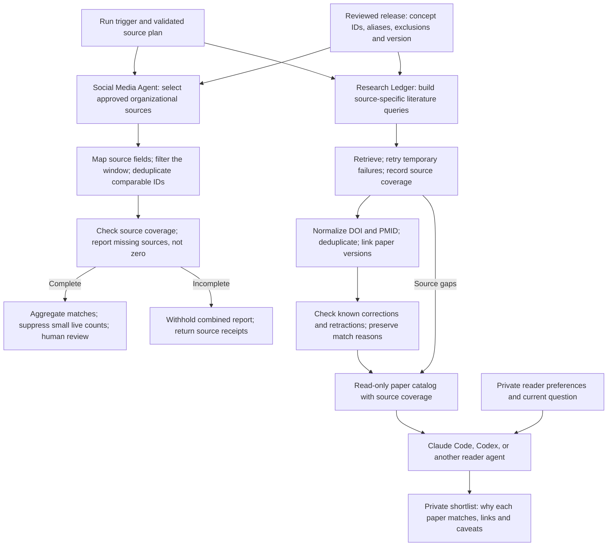

# Figure 1. Two agents sharing a reviewed lexicon

**Public-language path.** The [Social Media Agent prototype](https://github.com/nikbearbrown/social-media-agent/blob/8c70deb/agents/README.md) can demonstrate collection and normalization on fictional data. Public organizational language can suggest aliases or reveal ambiguity. It does not measure health events or validate clinical rules. Any match-level analysis in this paper is proposed for fictional data, not an existing live export.

**Literature path.** Research Ledger is a design, not a deployed system. Start with [PubMed via NCBI E-utilities](https://ncbi.nlm.nih.gov/home/develop/api/). Save query and lexicon versions, dates published and first indexed or seen, source and match field. Link preprints to journal versions when known. Use [Crossref and Retraction Watch](https://www.crossref.org/documentation/retrieve-metadata/retraction-watch/) as one source of known updates; unknown status is not a quality signal. Label source gaps and preserve the last good catalog if every source fails. Reader preferences filter and rank the catalog without changing collection; each shortlist distinguishes relevance from evidence quality. Store or export text only as permitted.

The two channels share reviewed terminology, not records, private preferences or evidence labels. Treat collected text as data, never instructions. A newly discovered phrase goes to human review before changing the lexicon. Do not join either channel to clinical records.
